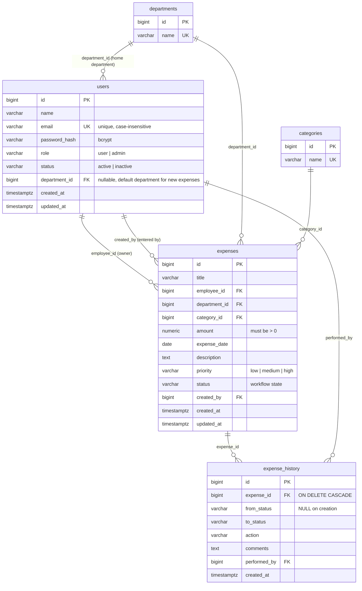

# ER Diagram

Renders automatically on GitHub and in VS Code (Markdown Preview Mermaid extension).

## Design notes
- **Normalized:** department and category names live in lookup tables; expenses and users store ids.
- **users.department_id:** the user's home department, pre-selected on new expenses. Nullable so a user can exist before one is assigned.
- **employee_id vs created_by:** both point to `users`. Only employees create expenses, so today both hold the same person. `created_by` is kept as the record of who entered it.
- **Status values:** `DRAFT, SUBMITTED, PROCESSING, APPROVAL_REQUIRED, APPROVED, COMPLETED, REJECTED, FAILED`. A CHECK constraint stops invalid values; the transition rules themselves live in the backend service (Module 6).
- **Indexes:** on the columns used for filtering, sorting and joining (`employee_id`, `status`, `department_id`, `expense_date`, `created_at`, and `expense_history.expense_id`).
- **History:** append-only audit log, one row per status change, which powers the timeline.
- **updated_at:** maintained by a database trigger, so the backend never has to set it.
